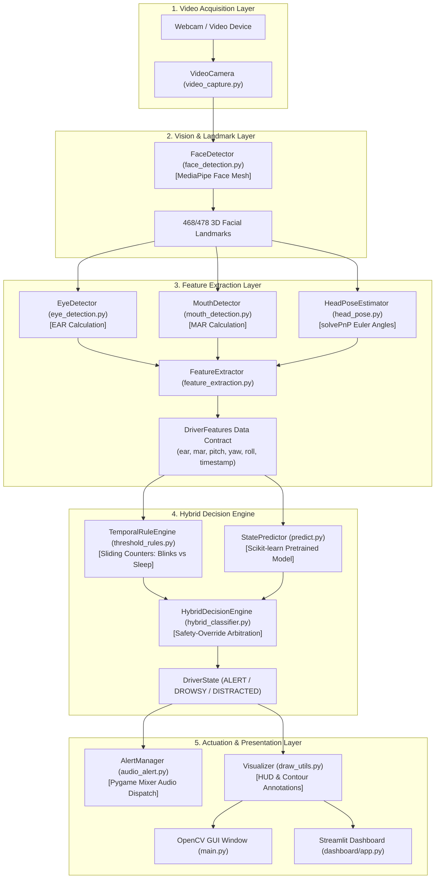
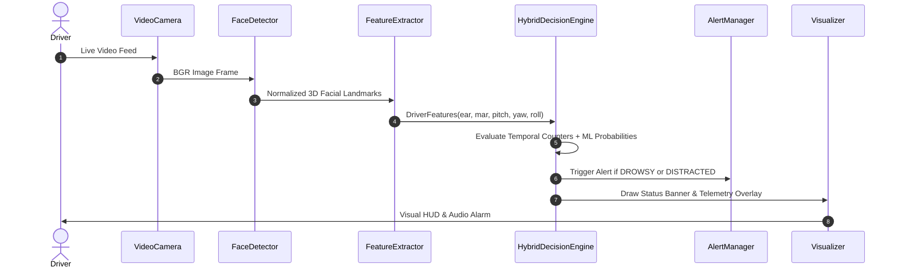
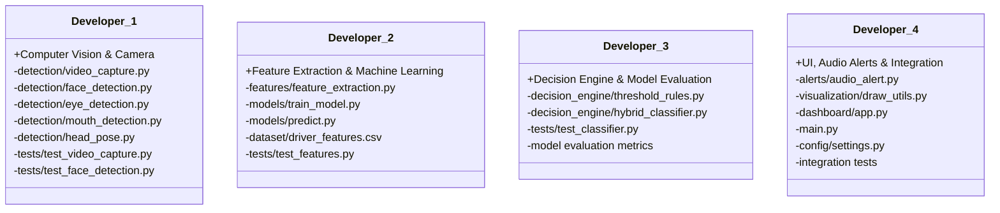
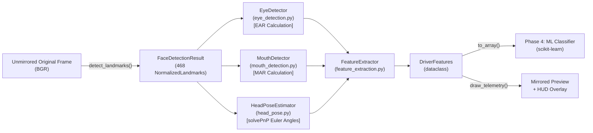
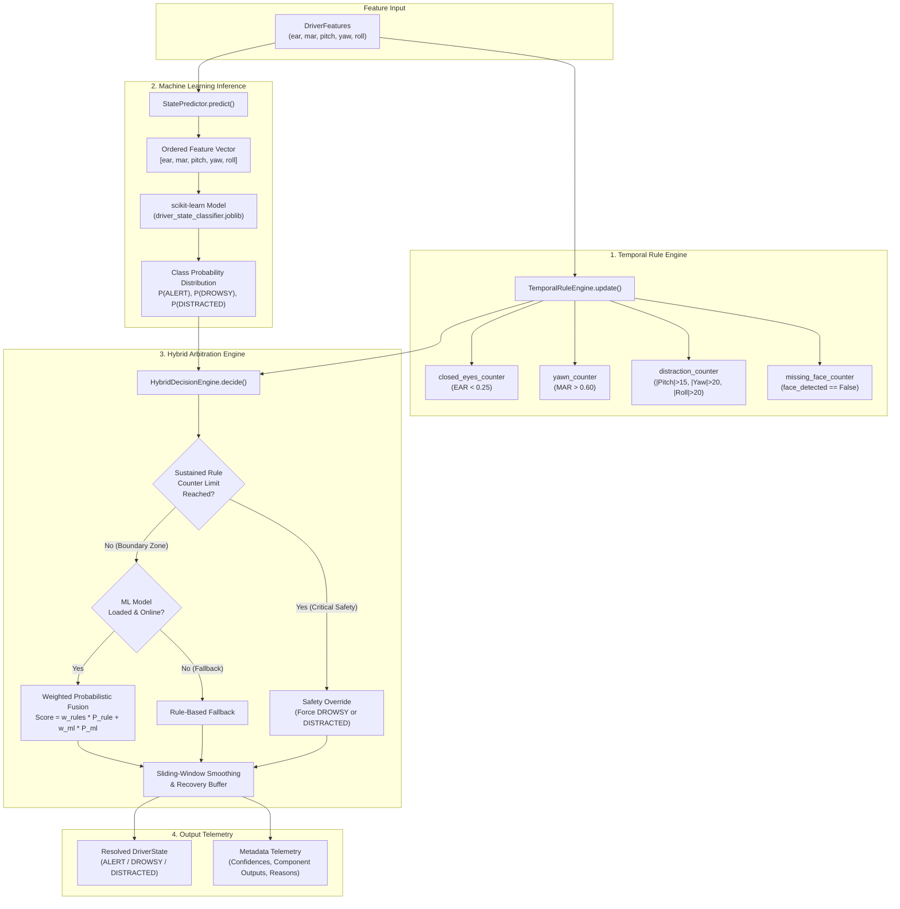
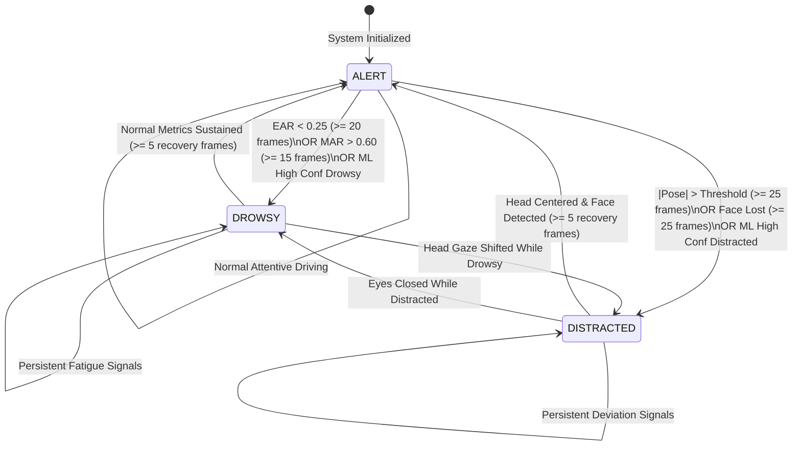
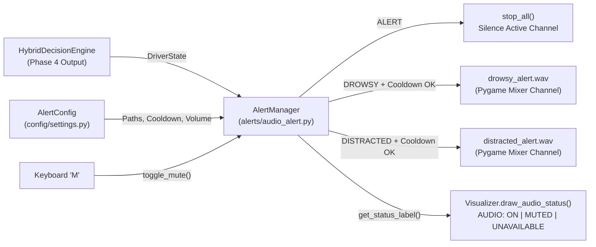

# Architecture Design Document
## Real-Time Driver Fatigue and Distraction Detection System

---

## 1. Executive Architecture Overview

The **Real-Time Driver Fatigue and Distraction Detection System** is designed as a modular, low-latency, computer-vision and machine-learning edge application. Its primary mission is continuous driver monitoring to detect physiological fatigue (prolonged eye closure, microsleeps, yawning) and behavioral distraction (looking off-road, nodding, head-turning), categorizing driver attentiveness into three mutually exclusive states:

1. **`ALERT`**: Driver is awake, attentive, with eyes open and gaze oriented toward the road ahead.
2. **`DROWSY`**: Driver exhibits signs of fatigue (sustained eye closure via suppressed Eye Aspect Ratio, or repetitive yawning via elevated Mouth Aspect Ratio).
3. **`DISTRACTED`**: Driver head orientation (Pitch, Yaw, Roll) deviates beyond safe angular boundaries away from the forward driving corridor.



---

## 2. Architectural Design Principles

1. **Strict Separation of Concerns (SoC)**:
   - Hardware capture, feature calculation, decision synthesis, and rendering reside in isolated modules.
2. **Frontend Agnosticism**:
   - The computer vision and decision engine do not depend on OpenCV display windows (`cv2.imshow`) or Streamlit UI widgets. Both `main.py` and `dashboard/app.py` consume the exact same underlying pipeline.
3. **Deterministic Safety Guarantees (Hybrid Decision Architecture)**:
   - Pure machine learning models can suffer from false negatives or boundary ambiguity. A deterministic temporal rule engine runs alongside the ML predictor: if eye closure exceeds critical safety thresholds (e.g., 1.5 seconds), the system triggers `DROWSY` regardless of ML output.
4. **Non-Blocking Execution**:
   - Audio alerts operate with cooldowns and execute asynchronously via Pygame Mixer so that audio output does not block frame capture or drop video frame rates.

---

## 3. Directory and File Responsibilities

| Path | Primary Responsibility |
|---|---|
| `main.py` | Orchestration entry point for standalone desktop OpenCV runtime. |
| `requirements.txt` | Pinned project dependencies strictly compatible with Python 3.11. |
| `README.md` | Developer onboarding, setup guidelines, and project roadmap. |
| `.gitignore` | Prevents commits of virtual environments, cache, datasets, and secrets. |
| `.env.example` | Template for environment variable overrides. |
| `config/__init__.py` | Package exposure for application settings. |
| `config/settings.py` | Centralized typed dataclasses for thresholds, camera, and model paths. |
| `detection/video_capture.py` | Video device acquisition, stream warmup, and graceful release. |
| `detection/face_detection.py` | MediaPipe Face Mesh wrapper extracting 468/478 normalized coordinates. |
| `detection/eye_detection.py` | Bilateral EAR computation and eye closure determination. |
| `detection/mouth_detection.py` | MAR calculation and yawning duration detection. |
| `detection/head_pose.py` | 3D head pose estimation using `cv2.solvePnP` (Pitch, Yaw, Roll). |
| `features/feature_extraction.py` | Aggregates individual metrics into the unified `DriverFeatures` dataclass. |
| `models/train_model.py` | Offline pipeline to train, validate, and serialize scikit-learn models. |
| `models/predict.py` | Online low-latency inference module using serialized model artifacts. |
| `models/saved_models/` | Storage directory for serialized model weights (`.joblib`). |
| `decision_engine/threshold_rules.py` | Sliding-window temporal persistence counters for eye/mouth/pose. |
| `decision_engine/hybrid_classifier.py` | Conflict resolver fusing temporal rules with statistical ML inference. |
| `alerts/audio_alert.py` | Asynchronous audio warning playback with anti-stutter cooldowns. |
| `alerts/sounds/` | Auditory warning asset store (`.wav` audio files). |
| `visualization/draw_utils.py` | Heads-Up Display (HUD) rendering, 3D axes, and status banner drawing. |
| `dashboard/app.py` | Streamlit interactive web dashboard and telemetry monitoring portal. |
| `dataset/raw/` | Unprocessed recordings and image sequences for dataset building. |
| `dataset/processed/` | Cleaned and normalized datasets for model training. |
| `dataset/driver_features.csv` | Feature store containing labeled tabular data `[ear, mar, pitch, yaw, roll, state]`. |
| `tests/test_video_capture.py` | Unit tests for camera lifecycle and frame capture. |
| `tests/test_features.py` | Unit tests for feature extraction vectors and mathematical consistency. |
| `tests/test_classifier.py` | Unit tests for rule counters, hybrid arbitration, and state enums. |
| `docs/architecture.md` | Full architectural specification and development guide. |

---

## 4. Inter-Module Data Contracts and Communication

### 4.1 Feature Vector Contract (`DriverFeatures`)
The pipeline standardizes metric transport through a strongly typed dataclass:
```python
@dataclass
class DriverFeatures:
    ear: float          # Average Eye Aspect Ratio
    mar: float          # Mouth Aspect Ratio
    pitch: float        # Head Pitch angle (degrees)
    yaw: float          # Head Yaw angle (degrees)
    roll: float         # Head Roll angle (degrees)
    timestamp: float    # Epoch timestamp in seconds
```

### 4.2 State Enum Contract (`DriverState`)
```python
class DriverState(str, Enum):
    ALERT = "ALERT"
    DROWSY = "DROWSY"
    DISTRACTED = "DISTRACTED"
```

### 4.3 Data Flow Sequence


---

## 5. Team Responsibility Allocation (4 Developers)

To enable concurrent, conflict-free development across four engineers, responsibilities are partitioned along clean module boundaries:



### Allocation Breakdown:

#### **Developer 1: Computer Vision & Camera Lead**
- **Ownership**: Video capture hardware abstraction, MediaPipe Face Landmarker integration, landmark extraction, EAR calculation, MAR calculation, and head pose estimation using `cv2.solvePnP`.
- **Git Branch**: `feat/computer-vision`
- **Deliverables**: Modules in `detection/`, `tests/test_video_capture.py`, `tests/test_face_detection.py`.

#### **Developer 2: Feature Extraction & Machine Learning Lead**
- **Ownership**: Feature aggregation (`DriverFeatures`), tabular dataset collection/curation (`driver_features.csv`), offline model training and validation (`train_model.py`), and online ML inference (`predict.py`).
- **Git Branch**: `feat/feature-extraction-ml`
- **Deliverables**: Modules in `features/`, `models/`, `dataset/driver_features.csv`, and feature vector unit tests (`tests/test_features.py`).

#### **Developer 3: Decision Engine & Model Evaluation Lead**
- **Ownership**: Temporal sliding counter logic (`threshold_rules.py`), deterministic safety overrides and conflict resolution (`hybrid_classifier.py`), ML evaluation metrics, confusion matrices, and decision engine unit tests.
- **Git Branch**: `feat/decision-engine`
- **Deliverables**: Modules in `decision_engine/`, decision tests (`tests/test_classifier.py`), model evaluation benchmarks.

#### **Developer 4: UI, Audio Alerts & System Integration Lead**
- **Ownership**: Centralized configuration management (`config/settings.py`), non-blocking Pygame audio notification system (`audio_alert.py`), OpenCV HUD overlays (`draw_utils.py`), Streamlit dashboard (`dashboard/app.py`), and `main.py` pipeline orchestration.
- **Git Branch**: `feat/ui-alerts-integration`
- **Deliverables**: Modules in `alerts/`, `visualization/`, `dashboard/`, `config/settings.py`, `main.py`, and integration tests.

---

## 6. Phased Development Roadmap

1. **Phase 1: Video Capture & Hardware Abstraction**
   - Initialize OpenCV webcam stream, handle frame resolution, and verify FPS latency.
2. **Phase 2: MediaPipe Face Mesh Landmark Extraction**
   - Extract 468/478 facial landmarks reliably under varied lighting conditions.
3. **Phase 3: Mathematical Feature Extraction (EAR, MAR, Head Pose)**
   - Implement Soukupová & Čech EAR equation, MAR equation, and 3D-to-2D `solvePnP` Euler angles.
4. **Phase 4: Hybrid Decision Engine & ML Training**
   - Collect feature vectors into CSV, train scikit-learn models, build temporal sliding counters, and implement hybrid decision fusion.
5. **Phase 5: Audio Alert Dispatch System**
   - Integrate Pygame Mixer, load alert sound assets, and calibrate cooldown timers.
6. **Phase 6: Interactive Streamlit Dashboard**
   - Build live Streamlit application with parameter sliders, real-time gauges, and webcam streams.
7. **Phase 7: End-to-End Integration, Testing & Optimization**
   - Benchmark pipeline latency (targeting > 20 FPS on standard CPUs), execute integration tests, and calibrate sensitivity thresholds.

---

## 7. Phase 2 Architecture: MediaPipe Face Landmarker Tasks Pipeline

Phase 2 introduces Google MediaPipe Face Landmarker Tasks API in `RunningMode.VIDEO` mode for temporal landmark tracking across continuous frames.

### 7.1 Coordinate Flow and Frame Mirroring Pipeline

To satisfy the dual requirements of **accurate facial landmark calculations** (which depend on original sensor camera geometry) and a **natural mirror experience** for the driver (raising right hand appears on right of screen):

```mermaid
flowchart LR
    CAM["Camera Sensor\n(Webcam)"] -->|"read_frame()"| RAW["Unmirrored Original Frame\n(BGR)"]
    RAW -->|"detect_landmarks()"| MP["MediaPipe Face Landmarker\n(RunningMode.VIDEO)"]
    MP -->|"NormalizedLandmarks\n(468/478 3D coords)"| RES["FaceDetectionResult"]
    RES -->|"draw_landmarks()"| ANNOT["Annotated Frame Copy\n(Contours & Mesh)"]
    ANNOT -->|"mirror_frame()\n(cv2.flip(..., 1))"| MIRROR["Mirrored Display Frame"]
    MIRROR -->|"draw_face_not_detected_banner()\n+ HUD Text"| HUD["Mirrored Frame with Readable HUD"]
    HUD -->|"cv2.imshow()"| GUI["Driver Window Preview"]
    HUD -->|"save_screenshot()"| PNG["Saved Mirrored Screenshot"]
```



### 7.2 Key Architectural Invariants
1. **Unmirrored Original Sensor Invariance**:
   - The unmirrored BGR frame is never modified or flipped before landmark extraction.
   - All geometric calculations — including EAR, MAR, and head pose `solvePnP` (Phase 3) — operate on the unmirrored frame coordinates to preserve true optical angles and camera matrix fidelity.
2. **Strict Monotonic Millisecond Timestamps**:
   - MediaPipe Tasks API in `RunningMode.VIDEO` requires strictly ascending timestamps (`t[i] > t[i-1]`). The `FaceDetector` enforces monotonicity automatically even when frames arrive with zero or negative jitter.
3. **Graceful Missing Face Handling**:
   - If no face is in view, `FaceDetectionResult.has_face` returns `False`, coordinates are `None`, and an amber "ALIGN FACE WITH CAMERA" HUD banner is displayed without pipeline crash or exception.
4. **Isolated Dependency Loading**:
   - Package `__init__.py` files remain completely lightweight; importing `detection.face_detection` or `detection.video_capture` introduces zero coupling to heavy ML, GUI, or audio libraries.

---

## 8. Phase 3 Architecture: Mathematical Feature Extraction

Phase 3 transforms raw 468/478 MediaPipe landmark coordinates into three quantitative facial metrics — **Eye Aspect Ratio (EAR)**, **Mouth Aspect Ratio (MAR)**, and **Head Pose angles (Pitch / Yaw / Roll)** — and aggregates them into a single `DriverFeatures` dataclass consumed by the Phase 4 decision engine.

### 8.1 Processing Pipeline



> [!NOTE]
> All calculations operate on the **unmirrored** original camera frame. The telemetry is overlaid on the mirrored display frame only at render time.

### 8.2 Eye Aspect Ratio (EAR)

The **Soukupová & Čech** formula measures vertical eye opening relative to horizontal eye width using 6 landmark points per eye:

$$\text{EAR} = \frac{\|p_2 - p_6\| + \|p_3 - p_5\|}{2 \cdot \|p_1 - p_4\|}$$

| Symbol | MediaPipe Index (Left Eye) | Role |
|---|---|---|
| p1 | 362 | Left corner |
| p2 | 385 | Upper-outer |
| p3 | 387 | Upper-inner |
| p4 | 263 | Right corner |
| p5 | 373 | Lower-inner |
| p6 | 380 | Lower-outer |

- **Open eye** → EAR ≈ 0.30–0.40  
- **Closed eye** → EAR < 0.21 (configurable `EyeConfig.ear_threshold`)  
- An epsilon guard (`1e-6`) prevents division by zero when `‖p1−p4‖ → 0`.  
- `compute_average_ear()` returns the bilateral mean: `(EAR_left + EAR_right) / 2`.

### 8.3 Mouth Aspect Ratio (MAR)

MAR measures vertical mouth opening relative to horizontal mouth width:

$$\text{MAR} = \frac{\|p_{\text{top}} - p_{\text{bottom}}\|}{\|p_{\text{left}} - p_{\text{right}}\|}$$

| Landmark | MediaPipe Index |
|---|---|
| p_top | 13 |
| p_bottom | 14 |
| p_left | 78 |
| p_right | 308 |

- **Mouth closed** → MAR ≈ 0.08–0.15  
- **Talking** → MAR ≈ 0.25–0.40  
- **Yawning** → MAR > 0.55 (configurable `MouthConfig.mar_threshold`)  
- Also supports a 6-point EAR-style calculation for extended geometry inputs.

### 8.4 Head Pose Estimation (solvePnP)

Head orientation is recovered via OpenCV's `cv2.solvePnP` by matching 6 canonical 3D model points to their 2D image projections:

| Canonical Point | 3D Model (mm, Y-down) | MediaPipe Index |
|---|---|---|
| Nose tip | (0, 0, 0) | 1 |
| Chin | (0, 330, −65) | 199 |
| Left eye corner | (225, −170, −135) | 33 |
| Right eye corner | (−225, −170, −135) | 263 |
| Left mouth corner | (150, 150, −125) | 61 |
| Right mouth corner | (−150, 150, −125) | 291 |

**Camera matrix** (resolution-independent):

```
focal_length = frame_width
K = [[f, 0, cx],
     [0, f, cy],
     [0, 0,  1]]     where cx = w/2, cy = h/2
```

**Euler decomposition**: `cv2.Rodrigues(rvec)` → rotation matrix → `cv2.RQDecomp3x3()` → raw angles → normalized to [−180°, +180°]:

| Angle | Sign Convention |
|---|---|
| Pitch | Positive = nodding down |
| Yaw | Positive = turning right |
| Roll | Positive = clockwise tilt |

> [!NOTE]
> A straight-on neutral face may show Roll ≈ ±180° due to Euler-angle gimbal ambiguity at the identity rotation. This is a known mathematical artifact of `RQDecomp3x3` and does not affect distraction detection thresholds.

### 8.5 DriverFeatures Dataclass Contract

`FeatureExtractor.extract_features(landmarks, frame_shape, timestamp)` returns a `DriverFeatures` instance:

```python
@dataclass
class DriverFeatures:
    timestamp: float          # Unix epoch seconds
    left_ear: float           # EAR for left eye
    right_ear: float          # EAR for right eye
    average_ear: float        # Bilateral mean EAR (alias: ear)
    mar: float                # Mouth Aspect Ratio
    pitch: float              # Head pitch in degrees
    yaw: float                # Head yaw in degrees
    roll: float               # Head roll in degrees
    face_detected: bool       # Whether MediaPipe found a face
    valid: bool               # All sub-results are valid
    ear: float                # Alias for average_ear (synchronized by __post_init__)
```

Conversion helpers:
- `to_dict()` → `dict[str, Any]` via `dataclasses.asdict()`
- `to_array(feature_order)` → `np.ndarray[float32]` in caller-specified column order (default: `['ear', 'mar', 'pitch', 'yaw', 'roll']`) for direct ML ingestion

### 8.6 Telemetry HUD Overlay

`visualization/draw_utils.py` provides two Phase 3 renderers applied to the mirrored preview frame:

| Function | Output |
|---|---|
| `draw_telemetry(frame, features, config)` | Semi-transparent card at top-left with EAR / MAR / Pose lines |
| `draw_head_pose_axes(frame, result, landmarks, config)` | RGB X/Y/Z axes projected from nose landmark |

> [!IMPORTANT]
> `draw_state_banner()` is implemented in Phase 4 to display color-coded status banners across ALERT, DROWSY, and DISTRACTED states.

### 8.7 Phase 3 Architectural Invariants

1. **Unmirrored computation**: EAR, MAR, and solvePnP always run on the original sensor frame.
2. **Epsilon guards**: All ratio calculations include a `1e-6` denominator guard to prevent division by zero at extreme landmark positions.
3. **Graceful degradation**: If `has_face` is `False` or fewer than 468 landmarks are present, `DriverFeatures.valid = False` and all float fields are `0.0` — the pipeline never raises an exception on missing face data.
4. **ML-ready output**: `to_array()` accepts an arbitrary `feature_order` list, ensuring zero coupling between the feature extractor and the Phase 4 classifier column schema.
5. **65 unit tests**: Phase 3 verified 65 tests running with zero hardware dependencies.

---

## 9. Phase 4: Hybrid Decision Engine & Machine Learning Classification

### 9.1 Hybrid Decision Architecture Overview

Phase 4 establishes an intelligent, multi-layered decision subsystem that classifies driver behavior into three primary states (`ALERT`, `DROWSY`, `DISTRACTED`). Rather than relying solely on black-box machine learning or static single-frame heuristics, Phase 4 unifies:

1. **Deterministic Temporal Heuristics** (`TemporalRuleEngine`): Physics-grounded safety thresholds evaluated over sliding temporal counters.
2. **Statistical ML Classification** (`StatePredictor`): Supervised multi-class classifiers (`RandomForest`, `GradientBoosting`, `SVC`) trained on continuous 5D feature vectors `[ear, mar, pitch, yaw, roll]`.
3. **Safety-Override Arbitration & Weighted Fusion** (`HybridDecisionEngine`): Deterministic rules guarantee safety; machine learning refines boundary decisions.
4. **Temporal Recovery & Sliding Smoothing**: Hysteresis buffers and majority voting suppress single-frame sensor noise and prevent erratic alarm oscillations.



---

### 9.2 Temporal Rule Engine & Heuristic Thresholds

The `TemporalRuleEngine` (`decision_engine/threshold_rules.py`) evaluates continuous biological ratios and orientation angles against safety baselines:

| Metric | Trigger Condition | Consec. Frames | Duration @ 20 FPS | Triggered State |
|:---|:---|:---:|:---:|:---:|
| **Eye Closure (EAR)** | `average_ear < 0.25` | `20` frames | `~1.00 s` | `DROWSY` |
| **Yawning (MAR)** | `mar > 0.60` | `15` frames | `~0.75 s` | `DROWSY` |
| **Head Pitch (Slumping/Nodding)** | `abs(pitch) > 15.0°` | `25` frames | `~1.25 s` | `DISTRACTED` / `DROWSY` |
| **Head Yaw (Looking Away)** | `abs(yaw) > 20.0°` | `25` frames | `~1.25 s` | `DISTRACTED` |
| **Head Roll (Lateral Tilt)** | `abs(roll) > 20.0°` | `25` frames | `~1.25 s` | `DISTRACTED` |
| **Missing Face** | `face_detected == False` | `25` frames | `~1.25 s` | `DISTRACTED` |

#### Architectural Guarantees:
- **No Single-Frame False Alarms**: A natural eye blink (lasting 100–300 ms, or ~3–6 frames) increments `closed_eyes_counter` but resets back to 0 immediately upon reopening. Only sustained closure reaching `ear_consec_frames` transitions to `DROWSY`.
- **Missing-Face Safety**: When landmarks are lost, facial counters decay rather than incrementing falsely. If face absence persists across `distraction_consec_frames`, the engine transitions to `DISTRACTED` (driver turned away completely from camera).
- **Hysteresis Recovery Duration**: Transitioning from an alarm state back to `ALERT` requires `recovery_consec_frames` (default 5 frames) of sustained normal driving metrics, preventing rapid on-off alarm flutter.

---

### 9.3 Machine Learning Pipeline (`models/`)

The machine learning subsystem consists of two modules:

1. **`models/train_model.py` (`ModelTrainer`)**:
   - Ingests tabular records matching the schema `[timestamp, ear, mar, pitch, yaw, roll, state]`.
   - Cleans missing values, NaN, and non-finite numbers.
   - Performs stratified train/test splitting (`stratify=y`) to maintain class ratios.
   - Fits scikit-learn estimators (`RandomForestClassifier`, `GradientBoostingClassifier`, or `SVC`).
   - Computes evaluation metrics: Accuracy, Precision (Macro), Recall (Macro), F1-Score (Macro), Confusion Matrix, and detailed classification report.
   - Serializes trained weights and metadata artifact to `models/saved_models/driver_state_classifier.joblib`.
   - Includes `generate_synthetic_testing_data()` strictly for automated CI/CD pipeline verification.

2. **`models/predict.py` (`StatePredictor`)**:
   - Deserializes `.joblib` model artifacts on startup.
   - Converts discrete `DriverFeatures` into an ordered DataFrame feature row matching the training schema.
   - Calls `predict_proba()` to compute probability distributions across `ALERT`, `DROWSY`, and `DISTRACTED`.
   - **Graceful Offline Degradation**: If the model artifact is absent or corrupted, `is_loaded()` returns `False` and `predict()` safely outputs a baseline fallback distribution without throwing exceptions.

---

### 9.4 Hybrid Arbitration & Temporal Smoothing Strategy

The `HybridDecisionEngine` (`decision_engine/hybrid_classifier.py`) manages arbitration between the heuristic rules and machine learning outputs:

1. **Safety Override Precedence**:
   - If the rule engine confirms sustained eye closure (`closed_eyes_counter >= ear_consec_frames`) or sustained yawning (`yawn_counter >= mar_consec_frames`), the deterministic safety override immediately forces `DROWSY`. An ML prediction of `ALERT` cannot override physical eye closure.
2. **Offline Rule Fallback**:
   - If `StatePredictor.is_loaded() == False`, the system automatically routes 100% of decisions through `TemporalRuleEngine`.
3. **Weighted Probabilistic Fusion**:
   - In ambiguous intermediate situations (e.g. eye half-closed, head slightly turned), combined class probabilities are calculated:
     $$\text{Score}(s) = w_{\text{rules}} \cdot P_{\text{rule}}(s) + w_{\text{ml}} \cdot P_{\text{ml}}(s)$$
   - Defaults: $w_{\text{rules}} = 0.5$, $w_{\text{ml}} = 0.5$ (normalized to sum to 1.0).
4. **Sliding-Window Majority Smoothing**:
   - A temporal queue (`collections.deque(maxlen=smoothing_window)`) stores recent state candidates.
   - Majority voting with safety bias prevents single-frame noise from triggering alarms.

---

### 9.5 State Transition Diagram



---

### 9.6 Phase 4 Architectural Invariants & Verification

1. **Safety Override Invariant**: Physiological evidence of prolonged eye closure or yawning always takes precedence over statistical classifier output.
2. **Offline Resilience**: The runtime application operates seamlessly with or without a trained ML model artifact.
3. **Zero Test Regressions**: All 65 existing Phase 1–3 tests continue to pass alongside 31 new Phase 4 tests (**total: 96 unit tests passing**).
4. **Unmirrored Sensor Integrity**: Real-time classification features are strictly computed from unmirrored camera coordinates, preserving true 3D perspective orientation.
5. **HUD Transparency**: The live video overlay surfaces both the final hybrid state, the ML class confidence, and the underlying rule counter telemetry.

---

## 10. Phase 5 Architecture: Audio Alert System Integration

Phase 5 adds non-blocking auditory safety notifications driven directly by the Phase 4 `HybridDecisionEngine` output via `AlertManager` (`alerts/audio_alert.py`), `AlertConfig` (`config/settings.py`), and `DriverMonitoringApp` (`main.py`).

### 10.1 Audio Alert Architecture



### 10.2 Driver State to Audio Mapping

| Driver State | Audio Behavior | Sound Asset |
|---|---|---|
| `DriverState.ALERT` | Silence active playback (`stop_all()` when `stop_on_alert=True`) | None |
| `DriverState.DROWSY` | Play urgent triple-pulse dual-tone warning (880 Hz + 1320 Hz, 0.82s) | `alerts/sounds/drowsy_alert.wav` |
| `DriverState.DISTRACTED` | Play ascending two-note attention chime (587.33 Hz -> 783.99 Hz, 0.56s) | `alerts/sounds/distracted_alert.wav` |

### 10.3 Alert Cooldown Mechanism

- Uses `time.monotonic()` to measure elapsed time since `_last_alert_time` (initialized to `None` so the first valid alert always triggers immediately).
- Any trigger arriving within `cooldown` seconds (`AlertConfig.cooldown_seconds`, default `3.0s`) is suppressed (`trigger_alert()` returns `False`), preventing frame-by-frame audio stutter at 20–30 FPS.
- If a different alert plays while an earlier channel is still busy, the previous channel is stopped cleanly before starting the new warning sound.
- Playback runs asynchronously on SDL/Pygame mixer threads so `cv2.read()` and inference loops are never blocked.

### 10.4 Audio Lifecycle

1. **Configuration**: `AlertManager` reads defaults from `AlertConfig` (`enable_audio`, `cooldown_seconds`, `volume`, `sound_drowsy_path`, `sound_distracted_path`, and mixer parameters).
2. **Initialization (`initialize()`)**: Verifies `pygame` and `pygame.mixer` availability, initializes the mixer once, sets channel count, and preloads existing `.wav` files into memory (zero disk I/O inside the video loop).
3. **Runtime Dispatch (`trigger_alert()`, `toggle_mute()`, `set_enabled()`, `set_volume()`)**: Routes `DriverState` decisions, handles `'m'` mute/unmute toggles (stopping active sound immediately upon mute), and surfaces `AUDIO: ON`, `AUDIO: MUTED`, or `AUDIO: UNAVAILABLE` via `get_status_label()` to `Visualizer.draw_audio_status()`.
4. **Teardown (`close()`)**: Called unconditionally in `DriverMonitoringApp.run()`'s `finally` block (as well as `__exit__`), stopping active channels, clearing preloaded `Sound` objects, and calling `pygame.mixer.quit()`.

### 10.5 Error Handling & Graceful Degradation

- **Missing `pygame`**: `initialize()` sets `_available = False`, logs a warning, and returns `False`; the video and HUD pipeline continues normally with `AUDIO: UNAVAILABLE`.
- **Mixer Initialization Failure**: Exceptions from `pygame.mixer.init()` (e.g., headless servers with no audio hardware) are caught cleanly without crashing `main.py`.
- **Missing or Corrupt Audio Assets**: Missing `.wav` paths are logged and skipped **without** silently substituting another state's audio file.
- **Playback Failure**: Errors in `Sound.play()` are caught and logged without consuming the cooldown timestamp or crashing the frame loop.

### 10.6 Integration with HybridDecisionEngine

Inside `DriverMonitoringApp.run()` (`main.py`), each frame flows strictly in order:
`VideoCamera.read_frame()` -> `FaceDetector.detect_landmarks()` (unmirrored) -> `FeatureExtractor.extract_features()` -> `HybridDecisionEngine.decide()` -> `AlertManager.trigger_alert(current_state)` -> `Visualizer` overlays (`draw_landmarks`, `mirror_frame`, `draw_state_banner`, `draw_telemetry`, `draw_audio_status`).

