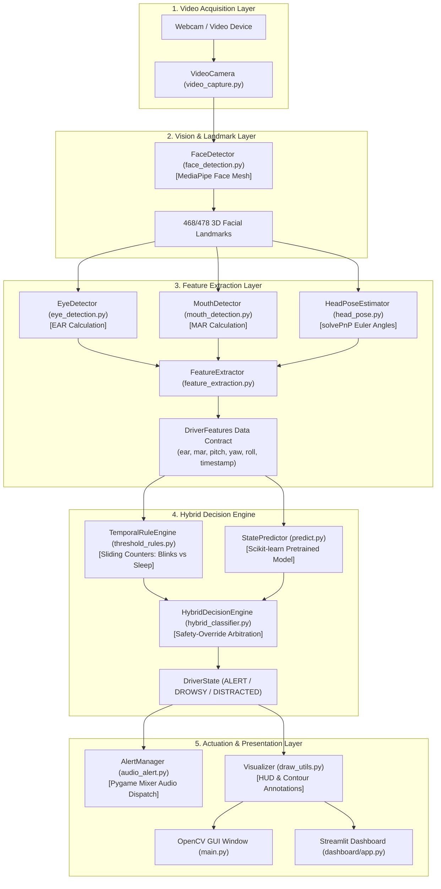
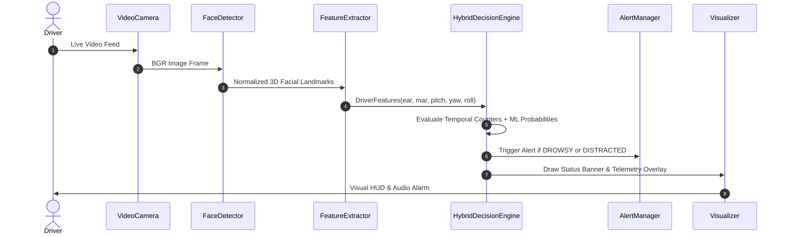
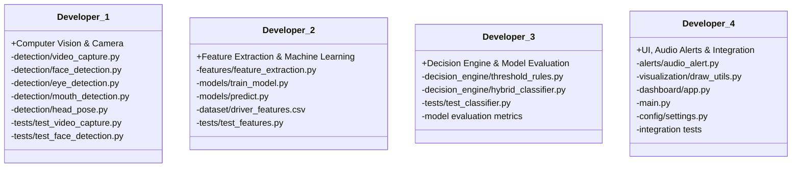

# Architecture Design Document
## Real-Time Driver Fatigue and Distraction Detection System

---

## 1. Executive Architecture Overview

The **Real-Time Driver Fatigue and Distraction Detection System** is designed as a modular, low-latency, computer-vision and machine-learning edge application. Its primary mission is continuous driver monitoring to detect physiological fatigue (prolonged eye closure, microsleeps, yawning) and behavioral distraction (looking off-road, nodding, head-turning), categorizing driver attentiveness into three mutually exclusive states:

1. **`ALERT`**: Driver is awake, attentive, with eyes open and gaze oriented toward the road ahead.
2. **`DROWSY`**: Driver exhibits signs of fatigue (sustained eye closure via suppressed Eye Aspect Ratio, or repetitive yawning via elevated Mouth Aspect Ratio).
3. **`DISTRACTED`**: Driver head orientation (Pitch, Yaw, Roll) deviates beyond safe angular boundaries away from the forward driving corridor.



---

## 2. Architectural Design Principles

1. **Strict Separation of Concerns (SoC)**:
   - Hardware capture, feature calculation, decision synthesis, and rendering reside in isolated modules.
2. **Frontend Agnosticism**:
   - The computer vision and decision engine do not depend on OpenCV display windows (`cv2.imshow`) or Streamlit UI widgets. Both `main.py` and `dashboard/app.py` consume the exact same underlying pipeline.
3. **Deterministic Safety Guarantees (Hybrid Decision Architecture)**:
   - Pure machine learning models can suffer from false negatives or boundary ambiguity. A deterministic temporal rule engine runs alongside the ML predictor: if eye closure exceeds critical safety thresholds (e.g., 1.5 seconds), the system triggers `DROWSY` regardless of ML output.
4. **Non-Blocking Execution**:
   - Audio alerts operate with cooldowns and execute asynchronously via Pygame Mixer so that audio output does not block frame capture or drop video frame rates.

---

## 3. Directory and File Responsibilities

| Path | Primary Responsibility |
|---|---|
| `main.py` | Orchestration entry point for standalone desktop OpenCV runtime. |
| `requirements.txt` | Pinned project dependencies strictly compatible with Python 3.11. |
| `README.md` | Developer onboarding, setup guidelines, and project roadmap. |
| `.gitignore` | Prevents commits of virtual environments, cache, datasets, and secrets. |
| `.env.example` | Template for environment variable overrides. |
| `config/__init__.py` | Package exposure for application settings. |
| `config/settings.py` | Centralized typed dataclasses for thresholds, camera, and model paths. |
| `detection/video_capture.py` | Video device acquisition, stream warmup, and graceful release. |
| `detection/face_detection.py` | MediaPipe Face Mesh wrapper extracting 468/478 normalized coordinates. |
| `detection/eye_detection.py` | Bilateral EAR computation and eye closure determination. |
| `detection/mouth_detection.py` | MAR calculation and yawning duration detection. |
| `detection/head_pose.py` | 3D head pose estimation using `cv2.solvePnP` (Pitch, Yaw, Roll). |
| `features/feature_extraction.py` | Aggregates individual metrics into the unified `DriverFeatures` dataclass. |
| `models/train_model.py` | Offline pipeline to train, validate, and serialize scikit-learn models. |
| `models/predict.py` | Online low-latency inference module using serialized model artifacts. |
| `models/saved_models/` | Storage directory for serialized model weights (`.joblib`). |
| `decision_engine/threshold_rules.py` | Sliding-window temporal persistence counters for eye/mouth/pose. |
| `decision_engine/hybrid_classifier.py` | Conflict resolver fusing temporal rules with statistical ML inference. |
| `alerts/audio_alert.py` | Asynchronous audio warning playback with anti-stutter cooldowns. |
| `alerts/sounds/` | Auditory warning asset store (`.wav` audio files). |
| `visualization/draw_utils.py` | Heads-Up Display (HUD) rendering, 3D axes, and status banner drawing. |
| `dashboard/app.py` | Streamlit interactive web dashboard and telemetry monitoring portal. |
| `dataset/raw/` | Unprocessed recordings and image sequences for dataset building. |
| `dataset/processed/` | Cleaned and normalized datasets for model training. |
| `dataset/driver_features.csv` | Feature store containing labeled tabular data `[ear, mar, pitch, yaw, roll, state]`. |
| `tests/test_video_capture.py` | Unit tests for camera lifecycle and frame capture. |
| `tests/test_features.py` | Unit tests for feature extraction vectors and mathematical consistency. |
| `tests/test_classifier.py` | Unit tests for rule counters, hybrid arbitration, and state enums. |
| `docs/architecture.md` | Full architectural specification and development guide. |

---

## 4. Inter-Module Data Contracts and Communication

### 4.1 Feature Vector Contract (`DriverFeatures`)
The pipeline standardizes metric transport through a strongly typed dataclass:
```python
@dataclass
class DriverFeatures:
    ear: float          # Average Eye Aspect Ratio
    mar: float          # Mouth Aspect Ratio
    pitch: float        # Head Pitch angle (degrees)
    yaw: float          # Head Yaw angle (degrees)
    roll: float         # Head Roll angle (degrees)
    timestamp: float    # Epoch timestamp in seconds
```

### 4.2 State Enum Contract (`DriverState`)
```python
class DriverState(str, Enum):
    ALERT = "ALERT"
    DROWSY = "DROWSY"
    DISTRACTED = "DISTRACTED"
```

### 4.3 Data Flow Sequence


---

## 5. Team Responsibility Allocation (4 Developers)

To enable concurrent, conflict-free development across four engineers, responsibilities are partitioned along clean module boundaries:



### Allocation Breakdown:

#### **Developer 1: Computer Vision & Camera Lead**
- **Ownership**: Video capture hardware abstraction, MediaPipe Face Landmarker integration, landmark extraction, EAR calculation, MAR calculation, and head pose estimation using `cv2.solvePnP`.
- **Git Branch**: `feat/computer-vision`
- **Deliverables**: Modules in `detection/`, `tests/test_video_capture.py`, `tests/test_face_detection.py`.

#### **Developer 2: Feature Extraction & Machine Learning Lead**
- **Ownership**: Feature aggregation (`DriverFeatures`), tabular dataset collection/curation (`driver_features.csv`), offline model training and validation (`train_model.py`), and online ML inference (`predict.py`).
- **Git Branch**: `feat/feature-extraction-ml`
- **Deliverables**: Modules in `features/`, `models/`, `dataset/driver_features.csv`, and feature vector unit tests (`tests/test_features.py`).

#### **Developer 3: Decision Engine & Model Evaluation Lead**
- **Ownership**: Temporal sliding counter logic (`threshold_rules.py`), deterministic safety overrides and conflict resolution (`hybrid_classifier.py`), ML evaluation metrics, confusion matrices, and decision engine unit tests.
- **Git Branch**: `feat/decision-engine`
- **Deliverables**: Modules in `decision_engine/`, decision tests (`tests/test_classifier.py`), model evaluation benchmarks.

#### **Developer 4: UI, Audio Alerts & System Integration Lead**
- **Ownership**: Centralized configuration management (`config/settings.py`), non-blocking Pygame audio notification system (`audio_alert.py`), OpenCV HUD overlays (`draw_utils.py`), Streamlit dashboard (`dashboard/app.py`), and `main.py` pipeline orchestration.
- **Git Branch**: `feat/ui-alerts-integration`
- **Deliverables**: Modules in `alerts/`, `visualization/`, `dashboard/`, `config/settings.py`, `main.py`, and integration tests.

---

## 6. Phased Development Roadmap

1. **Phase 1: Video Capture & Hardware Abstraction**
   - Initialize OpenCV webcam stream, handle frame resolution, and verify FPS latency.
2. **Phase 2: MediaPipe Face Mesh Landmark Extraction**
   - Extract 468/478 facial landmarks reliably under varied lighting conditions.
3. **Phase 3: Mathematical Feature Extraction (EAR, MAR, Head Pose)**
   - Implement Soukupová & Čech EAR equation, MAR equation, and 3D-to-2D `solvePnP` Euler angles.
4. **Phase 4: Hybrid Decision Engine & ML Training**
   - Collect feature vectors into CSV, train scikit-learn models, build temporal sliding counters, and implement hybrid decision fusion.
5. **Phase 5: Audio Alert Dispatch System**
   - Integrate Pygame Mixer, load alert sound assets, and calibrate cooldown timers.
6. **Phase 6: Interactive Streamlit Dashboard**
   - Build live Streamlit application with parameter sliders, real-time gauges, and webcam streams.
7. **Phase 7: End-to-End Integration, Testing & Optimization**
   - Benchmark pipeline latency (targeting > 20 FPS on standard CPUs), execute integration tests, and calibrate sensitivity thresholds.

---

## 7. Phase 2 Architecture: MediaPipe Face Landmarker Tasks Pipeline

Phase 2 introduces Google MediaPipe Face Landmarker Tasks API in `RunningMode.VIDEO` mode for temporal landmark tracking across continuous frames.

### 7.1 Coordinate Flow and Frame Mirroring Pipeline

To satisfy the dual requirements of **accurate facial landmark calculations** (which depend on original sensor camera geometry) and a **natural mirror experience** for the driver (raising right hand appears on right of screen):

```mermaid
flowchart LR
    CAM["Camera Sensor\n(Webcam)"] -->|"read_frame()"| RAW["Unmirrored Original Frame\n(BGR)"]
    RAW -->|"detect_landmarks()"| MP["MediaPipe Face Landmarker\n(RunningMode.VIDEO)"]
    MP -->|"NormalizedLandmarks\n(468/478 3D coords)"| RES["FaceDetectionResult"]
    RES -->|"draw_landmarks()"| ANNOT["Annotated Frame Copy\n(Contours & Mesh)"]
    ANNOT -->|"mirror_frame()\n(cv2.flip(..., 1))"| MIRROR["Mirrored Display Frame"]
    MIRROR -->|"draw_face_not_detected_banner()\n+ HUD Text"| HUD["Mirrored Frame with Readable HUD"]
    HUD -->|"cv2.imshow()"| GUI["Driver Window Preview"]
    HUD -->|"save_screenshot()"| PNG["Saved Mirrored Screenshot"]
```



### 7.2 Key Architectural Invariants
1. **Unmirrored Original Sensor Invariance**:
   - The unmirrored BGR frame is never modified or flipped before landmark extraction.
   - All geometric calculations (and future EAR, MAR, head pose `solvePnP` in Phase 3) operate on the unmirrored frame coordinates to preserve true optical angles and camera matrix fidelity.
2. **Strict Monotonic Millisecond Timestamps**:
   - MediaPipe Tasks API in `RunningMode.VIDEO` requires strictly ascending timestamps (`t[i] > t[i-1]`). The `FaceDetector` enforces monotonicity automatically even when frames arrive with zero or negative jitter.
3. **Graceful Missing Face Handling**:
   - If no face is in view, `FaceDetectionResult.has_face` returns `False`, coordinates are `None`, and an amber "ALIGN FACE WITH CAMERA" HUD banner is displayed without pipeline crash or exception.
4. **Isolated Dependency Loading**:
   - Package `__init__.py` files remain completely lightweight; importing `detection.face_detection` or `detection.video_capture` introduces zero coupling to heavy ML, GUI, or audio libraries.


